# Lab OpenSSL: Seguridad en PHP con OpenSSL y Libsodium

Laboratorio de **Desarrollo Web VII: PHP y MySQL** (Universidad Tecnológica de Panamá). Implementa funciones criptográficas en PHP para proteger datos sensibles, según los lineamientos de **OWASP** (categoría *Cryptographic Failures*): firma digital y verificación con RSA, certificado X.509 autofirmado, cifrado simétrico AES-128-CBC y cifrado autenticado con Libsodium.

Cada script tiene un formulario HTML para ingresar los datos y una hoja de estilos compartida (`estilos.css`).

**Autores:** Jazid Sánchez y Nohelis Castro · **Grupo:** 1s3122 · **Docente:** Ing. Irina Fong

---

## 1. Insertar registros (imágenes)

En este laboratorio no se usa base de datos: los "registros" son los datos que el usuario ingresa en los formularios y los resultados criptográficos que se generan a partir de ellos.

### Verificación del entorno

| `verificar.php` | Archivos del proyecto en el servidor |
|---|---|
| 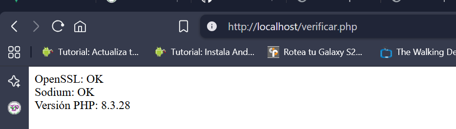 | 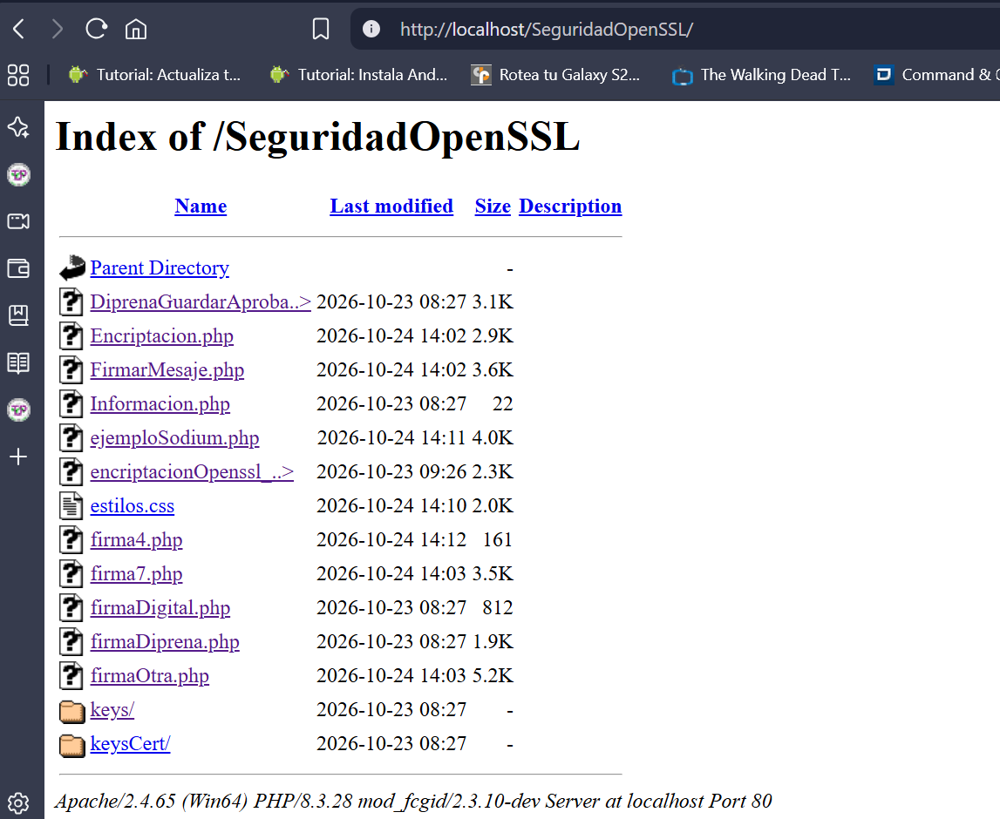 |

### firma7.php: firma digital RSA

| Ingreso del texto a firmar | Resultado de la firma |
|---|---|
| 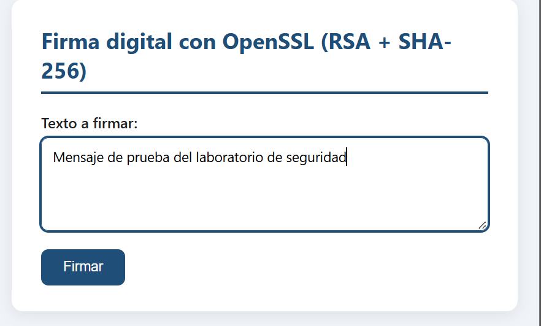 | 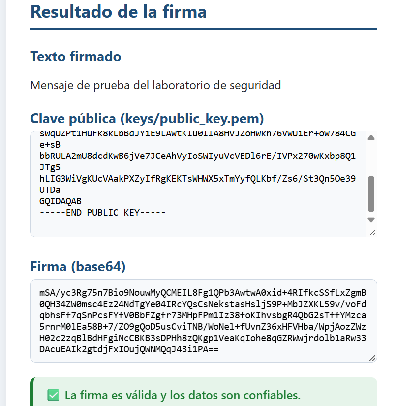 |

Clave pública generada (`keys/public_key.pem`):

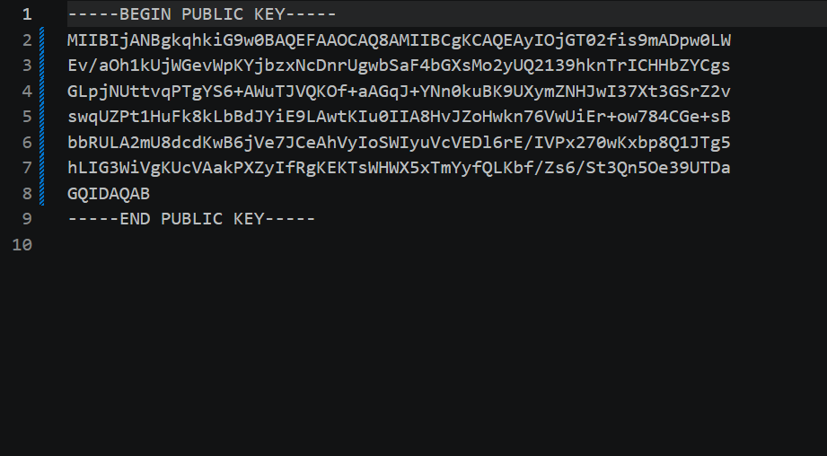

### firmaOtra.php: certificado X.509 autofirmado

| Ingreso de los datos del certificado | Resultado |
|---|---|
| 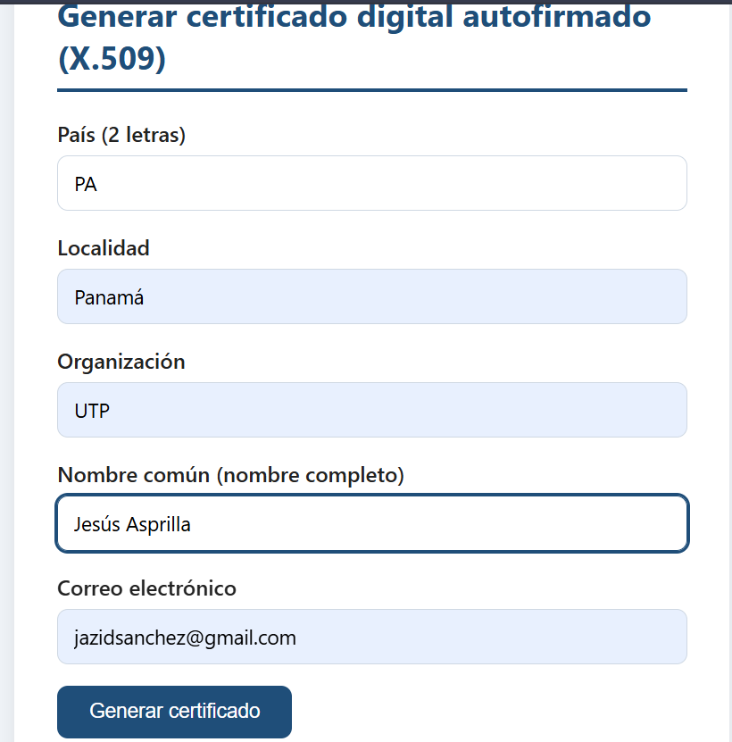 | 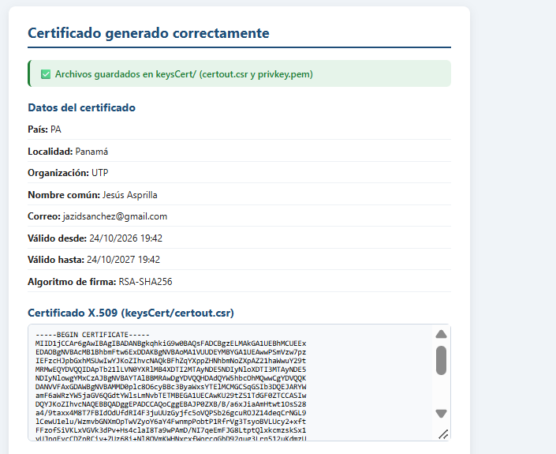 |

Certificado generado (`keysCert/certout.csr`):

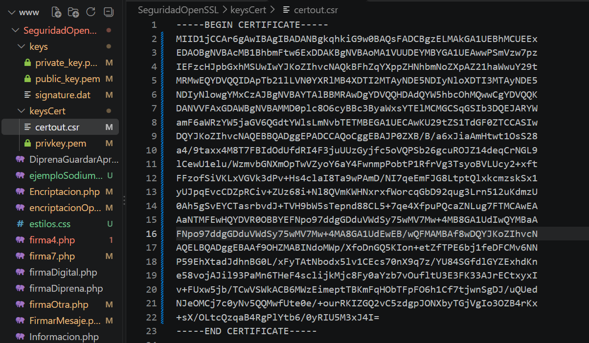

### Encriptacion.php: cifrado AES-128-CBC

| Ingreso del texto y la clave | Resultado del cifrado y descifrado |
|---|---|
| 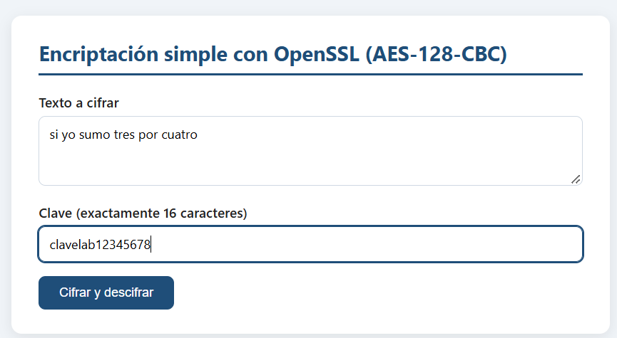 | 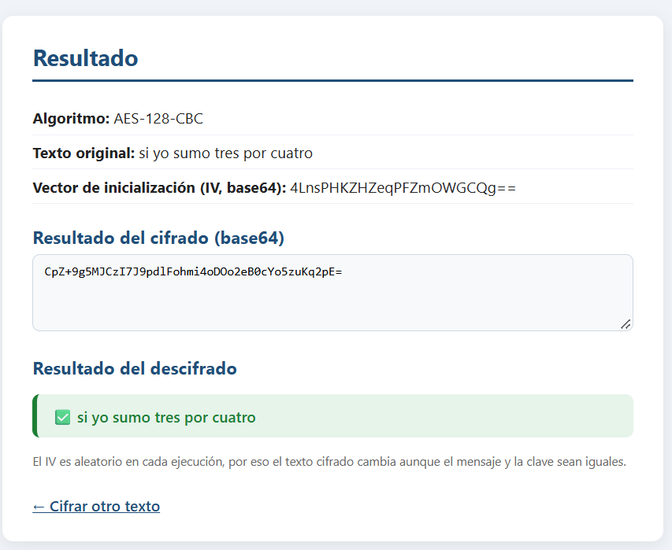 |

### ejemploSodium.php: Libsodium

| Ingreso del texto y la contraseña | Resultados |
|---|---|
| 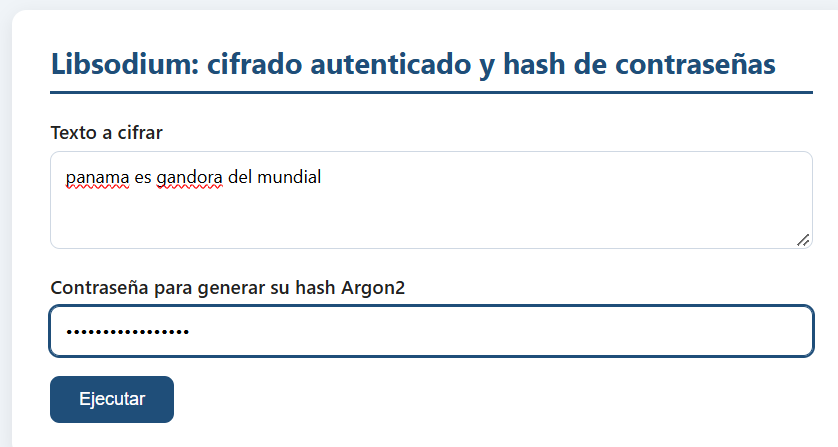 | 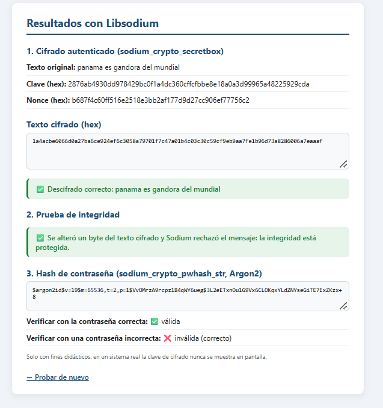 |

---

## 2. Evidencia de acciones de modificar (imágenes)

Modificar los datos firmados debe invalidar la verificación. En `FirmarMensaje.php` se firma un mensaje y luego se verifica con el mismo texto (firma válida) y con el texto alterado en una letra (firma inválida).

| Formulario | Firma válida | Mensaje modificado: firma inválida |
|---|---|---|
| 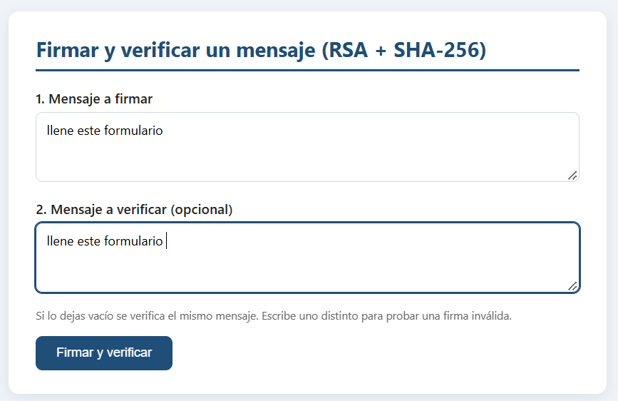 | 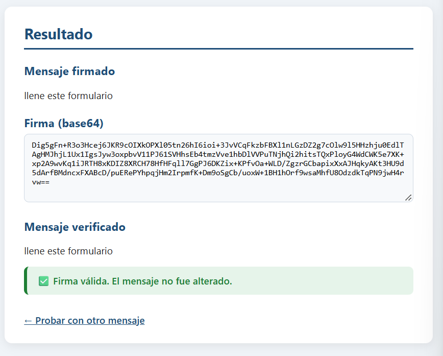 | 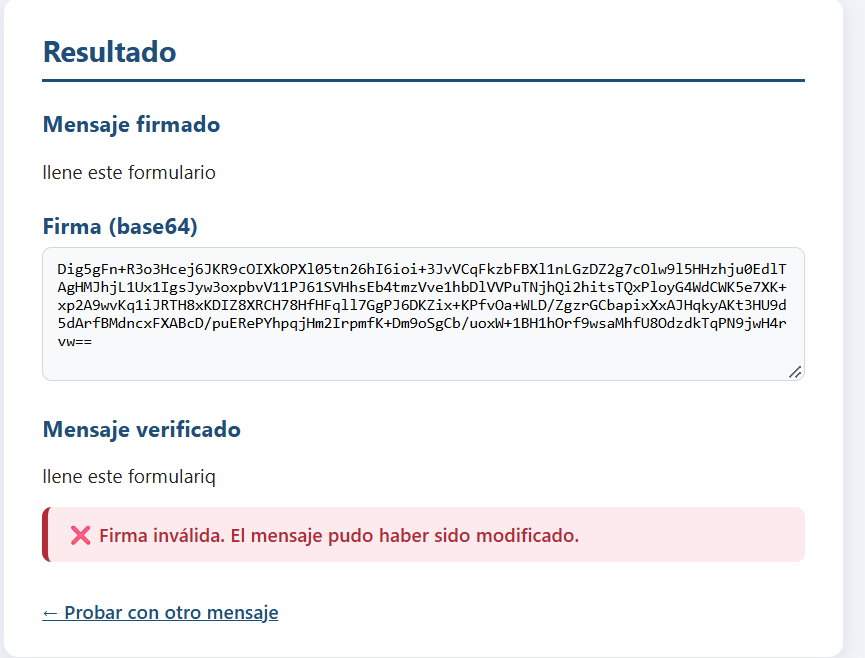 |

En `ejemploSodium.php` también se altera un byte del texto cifrado y `sodium_crypto_secretbox_open` lo rechaza (ver sección "2. Prueba de integridad" en la imagen de resultados de Sodium).

---

## 3. Evidencia de acciones de eliminar (imágenes)

**No aplica.** El laboratorio no maneja registros almacenados, por lo que no hay operación de eliminar. Las claves y firmas se regeneran en cada ejecución y las carpetas `keys/` y `keysCert/` se pueden vaciar sin afectar el código.

---

## 4. Controles utilizados

| Control | Dónde se aplica |
|---|---|
| Firma digital RSA de 2048 bits con SHA-256 (integridad y autenticidad) | `firma7.php`, `FirmarMensaje.php` |
| Certificado X.509 autofirmado (RSA-SHA256, 365 días) | `firmaOtra.php` |
| Cifrado simétrico AES-128-CBC con IV aleatorio (confidencialidad) | `Encriptacion.php` |
| Cifrado autenticado XSalsa20-Poly1305 con nonce aleatorio | `ejemploSodium.php` |
| Hash de contraseñas con Argon2id y sal aleatoria | `ejemploSodium.php` |
| Validación de entradas: campos obligatorios, clave de exactamente 16 caracteres, país de 2 letras | formularios de todos los scripts |
| Escape de la salida con `htmlspecialchars` (prevención de XSS) | todos los scripts |
| Manejo de errores con `openssl_error_string()` y mensajes controlados | `firma7.php`, `firmaOtra.php`, `FirmarMensaje.php` |
| Comprobación de que existen las claves antes de usarlas | `FirmarMensaje.php` |
| Claves privadas fuera del repositorio (`.gitignore`) | repositorio |

> Las claves privadas se muestran en pantalla solo con fines didácticos. En un sistema real nunca deben mostrarse ni guardarse sin protección.

---

## 5. Detalles del laboratorio

**Objetivo:** aplicar la extensión OpenSSL y la librería Libsodium en PHP para proteger datos sensibles, y documentar el proceso criptográfico de cada función.

| Archivo | Qué hace |
|---|---|
| `verificar.php` | Comprueba que las extensiones `openssl` y `sodium` estén habilitadas |
| `firma7.php` | Genera un par de claves RSA, firma un texto y verifica la firma |
| `firmaOtra.php` | Crea la solicitud (CSR) y el certificado X.509 autofirmado |
| `FirmarMensaje.php` | Firma un mensaje con la clave privada y lo verifica con el certificado |
| `Encriptacion.php` | Cifra y descifra un texto con AES-128-CBC |
| `ejemploSodium.php` | Cifrado autenticado, prueba de integridad y hash Argon2id con Libsodium |
| `estilos.css` | Estilos compartidos de los formularios |

Estructura del repositorio:

```
Lab-OpenSSL/
├── imagenes/            capturas usadas en este README
├── keys/                claves de firma7.php (se generan al ejecutar)
├── keysCert/            certificado y clave de firmaOtra.php (se generan al ejecutar)
├── verificar.php
├── firma7.php
├── firmaOtra.php
├── FirmarMensaje.php
├── Encriptacion.php
├── ejemploSodium.php
├── estilos.css
└── README.md
```

Código de los scripts:

| firma7.php | firmaOtra.php |
|---|---|
| 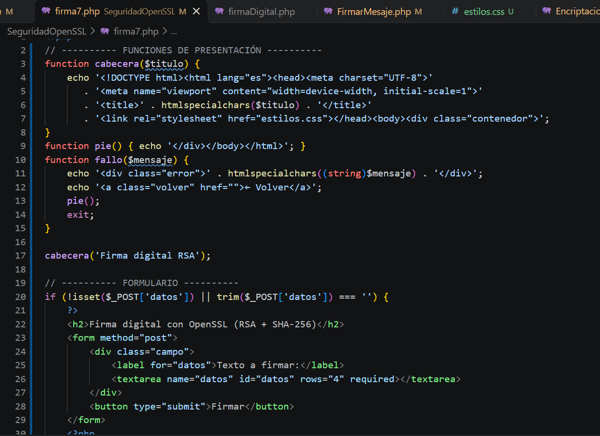 | 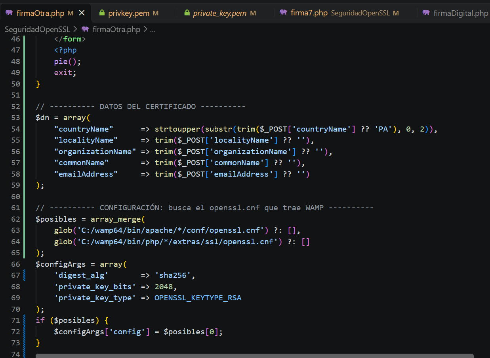 |

| FirmarMensaje.php | Encriptacion.php | ejemploSodium.php |
|---|---|---|
| 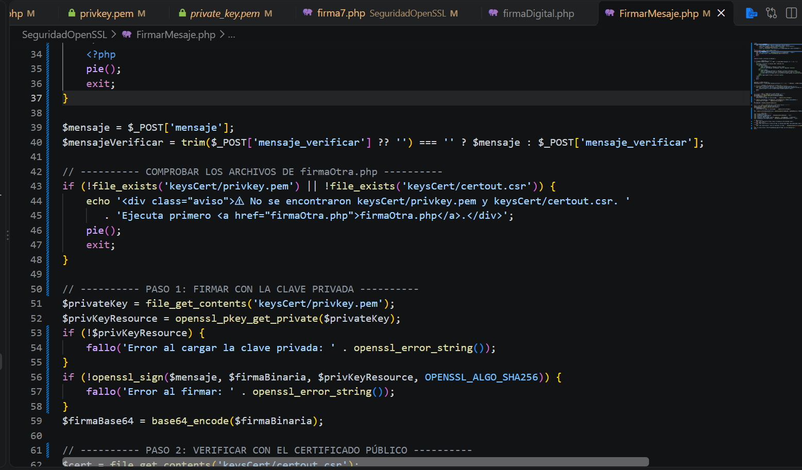 | 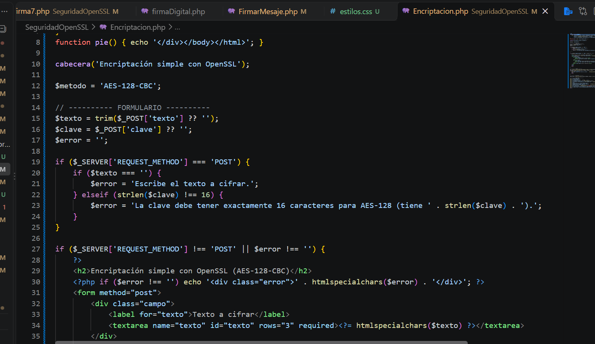 | 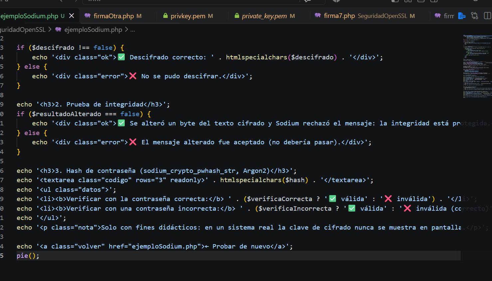 |

**Problema encontrado:** los scripts originales usaban la ruta fija `C:\OpenSSL-Win64\bin\cnf\openssl.cnf`, que no existe en WAMP. Se resolvió buscando el archivo con `glob()` en `C:/wamp64/bin/apache/*/conf/openssl.cnf` y pasándolo a la opción `config` solo si se encuentra.

---

## 6. Procesos de instalación

1. Instalar **WAMP** y encender los servicios (ícono verde).
2. Verificar que estén marcadas las extensiones `openssl` y `sodium` (menú de WAMP → PHP → Extensiones PHP).
3. Clonar el repositorio dentro de la carpeta `www` de WAMP:

   ```powershell
   cd C:\wamp64\www
   git clone https://github.com/jazidsanchez-create/Lab-OpenSSL.git
   ```

4. Copiar `verificar.php` a la raíz de `www` si se quiere probar el entorno (o abrirlo desde la carpeta del proyecto).
5. Abrir en el navegador:
   - `http://localhost/Lab-OpenSSL/firma7.php`
   - `http://localhost/Lab-OpenSSL/firmaOtra.php`
   - `http://localhost/Lab-OpenSSL/FirmarMensaje.php` (requiere ejecutar antes `firmaOtra.php`)
   - `http://localhost/Lab-OpenSSL/Encriptacion.php`
   - `http://localhost/Lab-OpenSSL/ejemploSodium.php`
6. Las claves y los certificados se crean solos en `keys/` y `keysCert/` al ejecutar los scripts. No se suben al repositorio.

---

## 7. Tecnologías y versiones

| Tecnología | Versión / detalle |
|---|---|
| Sistema operativo | Windows |
| Servidor | WAMP con Apache 2.4.65 (Win64) |
| Lenguaje | PHP 8.3.28 |
| Extensiones PHP | `openssl` y `sodium` (Libsodium incluida desde PHP 7.2) |
| Front-end | HTML5 y CSS3 |
| Editor | Visual Studio Code |
| Control de versiones | Git y GitHub |

---

## 8. Detalles del autor, fecha y referencias

**Autores:** Jazid Sánchez y Nohelis Castro
**Institución:** Universidad Tecnológica de Panamá, Facultad de Ingeniería de Sistemas Computacionales
**Asignatura:** Desarrollo Web VII: PHP y MySQL
**Docente:** Ing. Irina Fong
**Grupo:** 1s3122
**Período:** II Semestre 2026
**Fecha de entrega:** 30 de octubre de 2026

**Referencias**

- Archivos base del laboratorio, proporcionados por la docente: https://github.com/Salomon2514/SeguridadOpenSSL
- PHP Manual, extensión OpenSSL: https://www.php.net/manual/es/book.openssl.php
- PHP Manual, extensión Sodium: https://www.php.net/manual/es/book.sodium.php
- OWASP Top 10:2021, A02 Cryptographic Failures: https://owasp.org/Top10/A02_2021-Cryptographic_Failures/
- OWASP Password Storage Cheat Sheet: https://cheatsheetseries.owasp.org/cheatsheets/Password_Storage_Cheat_Sheet.html
